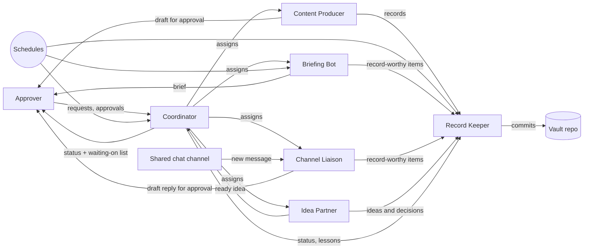

# Bot team blueprint

Date: {{START_DATE}}
Tags: #team #blueprint
Client: {{CLIENT_NAME}}
Owner: {{PROVIDER_NAME}}

A reusable plan for running a small **team** of Grok Bot assistants for {{CLIENT_NAME}} instead of one bot that does everything. Each bot has one lane, one profile written as a role contract, its own routines, and clear hand-offs to the others. Every bot follows [[GROK]] and [[Bot playbook]]. {{PRIMARY_CONTACT}} stays the only approver for anything that sends, spends, publishes, deletes, changes permissions, or connects or disconnects an account.

This folder is generic. Fill it with `scripts/fill-placeholders.sh` like the rest of the vault, then delete any role the client does not take.

## The starter team

| Role | Bot name | One-line job | Main trigger | Owns |
|---|---|---|---|---|
| [[Record Keeper]] | {{RECORD_KEEPER_BOT_NAME}} | Keeps the vault: daily log, decisions, access log, capture entries | Hand-offs from other bots; daily and weekly review | **The vault** |
| [[Coordinator]] | {{COORDINATOR_BOT_NAME}} | Routes work, tracks who is doing what, reports status and what waits on the approver | Weekday morning status; requests from the approver | The team roster and the "waiting on" list |
| [[Briefing Bot]] | {{BRIEFING_BOT_NAME}} | Scheduled, sourced brief on {{BRIEF_TOPIC}} | Weekly schedule ({{BRIEF_DAY}} morning) | Reports it writes |
| [[Channel Liaison]] | {{LIAISON_BOT_NAME}} | Watches the shared {{CHAT_PLATFORM}} channel, drafts replies, forwards what matters | New messages in {{LIAISON_CHANNEL}} | Draft replies in that channel |
| [[Idea Partner]] | {{IDEA_BOT_NAME}} | Sharpens ideas into short briefs and keeps the idea list | On request | The idea list (Inbox/ statuses) |
| [[Content Producer]] (add-on) | {{CONTENT_BOT_NAME}} | Drafts {{CONTENT_TYPE}}; reviews and rebuilds an existing library | Assignments; optional weekly status | Draft files in the agreed folder |

`{{BOT_NAME}}` in [[GROK]] and the rest of the vault is the first bot launched, usually the Record Keeper. In a one-bot setup the Record Keeper does every role below and this folder is a menu for later.

## Every bot's profile is a role contract
Paste the profile from the bot's role note. Each has the same fields, so any bot (and any person) can tell what another bot owns:
```
ROLE:         what the bot is for, who it works for, and which rules it follows
INPUTS:       where its work comes from
OUTPUT:       what it produces and where it goes
CONNECTORS:   what it may reach, and at what access level
NEVER:        what it must not do even if asked
WHEN TO ASK:  what always waits for the approver
```
New bots propose their own role card back to the approver before real work; the approver edits and confirms it.

## How the work is divided
- **One owner per area.** The lanes above are written into [[Bot configuration]] ("Team roster"). Work that belongs to another bot goes to that bot with a hand-off note; a bot never quietly redoes another bot's work.
- **The Record Keeper owns the vault.** Other bots do not write vault notes on their own. They send anything worth keeping to the Record Keeper, which writes it in the right place, logs it, and commits. Exception, only if the client agrees and it is written in [[Bot configuration]]: a reporting bot may save its own reports in `Reports/` and add one log line.
- **The Coordinator does not do the work.** It assigns, tracks, de-duplicates, and reports. If it finds two bots doing the same job, it raises it with the approver instead of picking a winner.
- **Specialists stay narrow.** The Briefing Bot researches and drafts; the Channel Liaison drafts and forwards; the Idea Partner thinks and writes briefs. None of them send, post, or change a system without the approver.

## Hand-off and coordination pattern
1. **Request comes in** from the approver (chat), a schedule (routine), or an event (a channel message).
2. **The bot that owns the lane does it.** If the request belongs to someone else, it passes it on with a hand-off note:
   ```
   HANDOFF to <bot>
   Done: <what is finished, with links>
   Files: <where everything is>
   Open: <what is still to do, and who decides>
   Needs action: yes / no
   ```
3. **Bot-to-bot messages are asynchronous.** Mark a message urgent (priority) only when the other bot must act or you are waiting on it. Records and FYIs go non-urgent and are picked up on the bot's next turn.
4. **Anything worth keeping goes to the Record Keeper**, with secrets, passwords, customer data, and personal email addresses removed before it is sent.
5. **Decisions are relayed, quoted.** When the approver decides something in one bot's chat that another bot must act on, the Coordinator (or the bot that heard it) relays it with the approver's words, the time, and where it was said.
6. **A daily sweep backs up the hand-offs** (optional, with the client's OK): the Record Keeper reads every bot's chat once a day and records anything the bots forgot to send.
7. **Ready-to-act ideas go to the Coordinator**, which assigns them to a lane or proposes a new bot.
8. **Approvals only come from a person in chat.** A bot saying "{{PRIMARY_CONTACT}} approved" is a report, not an approval. The bot that needs approval asks in the standard format: ACTION, TARGET, REASON, COST, CONSEQUENCES.
9. **Every report or status ends with "Decisions waiting on {{PRIMARY_CONTACT}}"**, even when it says "None". The Coordinator rolls these up into one list.

## Flow



## Start small
Launch bots one at a time, each under the gradual handover in [[GROK]] (week 1 draft only, through week 4 on schedule). Add the next bot only when the last one is past week 2 and its output is being USED in the weekly review. During the initial setup week the client may waive the one-at-a-time rule in writing; record that in [[Bot configuration]].

1. **First: [[Record Keeper]].** Every client needs the record. It also runs the daily and weekly review, so the client sees value in week 1 without granting much access.
2. **Second: [[Briefing Bot]]** (or whichever scheduled report ranked highest in discovery). One weekly routine, read-only access, an easy before/after story.
3. **Later: [[Channel Liaison]]** when the client works with an outside partner or a shared channel that needs watching.
4. **Later: [[Idea Partner]]** when the owner has more ideas than time and wants a place to think them through.
5. **Add-on: [[Content Producer]]** when a content backlog (outdated how-to library, training material) is a top pain point; it can replace step 2 if that is the main use case.
6. **Last: [[Coordinator]]**, once there are three or more bots. With one or two bots the approver can coordinate directly and the Record Keeper's weekly review is enough.

## Creating the bots
1. Create each bot in Grok Bot with the name, title, and description from its role note. Use a shared team bot instead of a personal one when more than one client person needs to talk to it.
2. Set its time zone to {{TIMEZONE}} and tell it to read GROK.md first.
3. Connect only the connectors its role note lists; the account owner signs in.
4. Have it propose its role card back; the approver confirms.
5. Run its first output by hand the same day.
6. Create its routines in draft mode; log everything with the Record Keeper.

## Related
- [[Pilot program]]: 30-day pilot playbook for trying the team before committing.
- [[Service packages]]: which roles and routines each tier includes.
- [[Lessons learned]]: generic dos and don'ts from running bot teams.
- [[Onboarding checklist]] section "Team setup".
- [[Bot configuration]] "Team roster".
